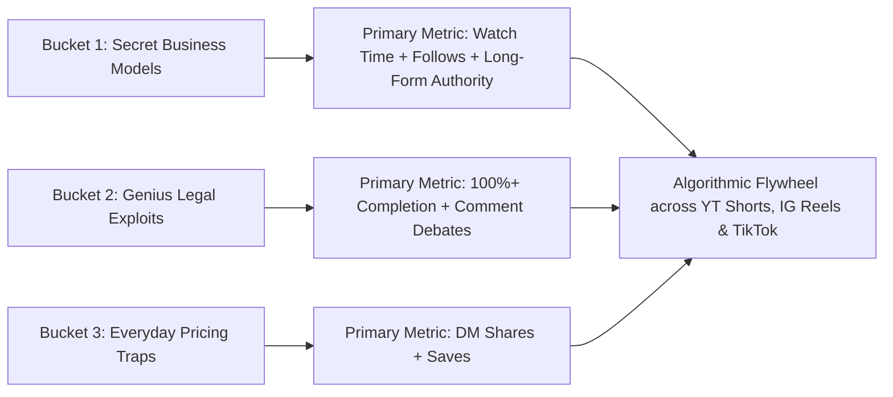
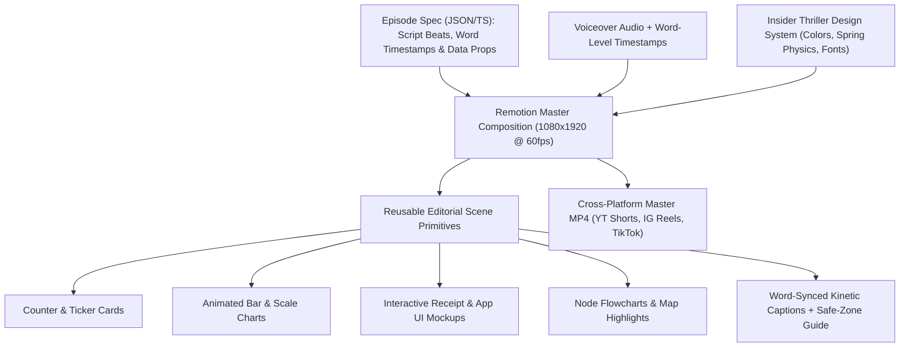

# Viral Short-Form Video Blueprint: "Hidden Money & Loopholes"

> [!IMPORTANT]
> **Aligned Strategic Positioning**
> - **Format:** Faceless voiceover studio powered by a programmatic **Remotion + React/TypeScript** video engine (`1080x1920`, `60fps`).
> - **Target Sweet Spot:** "Smart Viral" (`1M–10M+` cross-platform views per hit + high-CPM sponsor & long-form YouTube expansion appeal).
> - **Channel Focus:** Single flagship brand dedicated 100% to **Hidden Economics & System Loopholes** across 3 repeatable content buckets.
> - **Aesthetic & Voice:** Sleek **"Insider Thriller"** dark-mode editorial visuals paired with a custom-designed/cloned AI narrator (never stock TTS presets).
> - **Duration Strategy:** `45–58s` high-retention launch sprints (maximizing `>95%` completion & loop rates from 0 followers), shifting to `62–75s` post-10K followers to unlock TikTok Creator Rewards RPMs.

---

## 1. Brand Identity & Naming Contenders

To make Costco hot dog math or airline loyalty programs feel like *Ocean's Eleven*, the channel name should sound sharp, insider, and slightly conspiratorial—without feeling scammy or "hustle-bro."

| Brand Name | Handle Pattern | Positioning Angle |
| :--- | :--- | :--- |
| **Hidden Margin** *(Recommended)* | `@hiddenmargin` / `@thehiddenmargin` | Clean, authoritative, instantly signals secret profit mechanics and pricing traps; transitions effortlessly to a 10-minute YouTube show or newsletter. |
| **System Glitch** | `@systemglitch.tv` / `@thesystemglitch` |Leans slightly heavier into the "Genius Legal Exploits" & loopholes energy. |
| **Fine Print** | `@readfineprint` / `@thefineprinthq` | Investigative thriller vibe—every story lives in the clauses nobody reads. |
| **Unfair Math** | `@unfairmath` / `@theunfairmath` | Punchy, curiosity-inducing, fits counter-intuitive business models and retail traps equally well. |
| **Quiet Billions** | `@quietbillions` | High-status Bloomberg/FT aesthetic; great for invisible monopolies and corporate cash engines. |

---

## 2. The 3-Bucket Viral Rotation Engine

Rotating across **three distinct psychological triggers** keeps your feed unpredictable to human viewers while training YouTube Shorts, Instagram Reels, and TikTok algorithms on the **exact same high-value audience cohort**.

### Recommended Weekly Cadence (3–5 Videos / Week)
- **Monday (Bucket 1 — Secret Business Model):** Authority & curiosity builder.
- **Wednesday (Bucket 3 — Everyday Pricing Trap):** High DM-share & save velocity mid-week.
- **Friday (Bucket 2 — Genius Legal Exploit):** Weekend thriller story for massive completion & comments.

---

## 3. Vetted 18-Episode Viral Backlog (Fact-Checked)

Every concept below is grounded in real, verifiable financial/legal/academic history and maps cleanly to dark-mode UI, receipt, map, and chart animations.

### Bucket 1: Secret Business Models (*"Wait, THAT'S how they actually make money?"*)

| # | Episode Concept | 0-Second Spoken Hook | Visual Frame-1 Hook | Core Financial Payoff |
| :--- | :--- | :--- | :--- | :--- |
| **1** | **Starbucks' \$2B Shadow Bank** *(Ep #1 Pilot)* | *"Starbucks isn't a coffee company anymore—it's an unregulated bank holding nearly two billion dollars of your cash."* | Starbucks cup morphing into a glowing dark-mode bank vault ticker hitting `\$1.8B` | App balances = `0%` interest customer loan larger than `85%` of US community banks + ~`\$200M/yr` unspent breakage. |
| **2** | **Airlines Are Frequent-Flyer Banks That Happen to Own Planes** | *"If Delta stopped flying passengers tomorrow, the part of the company that actually makes money wouldn't flinch."* | Split bar chart: Flight Operations (`-` / razor-thin) vs. SkyMiles (`\$25B+` valuation) | Selling miles to Amex/Chase generates `50%+` margins; loyalty programs are worth more than the airlines' market caps. |
| **3** | **Costco's \$1.50 Hot Dog & Membership Float** | *"Costco built two massive meat factories just so it would never have to raise this hot dog by ten cents."* | `1985: \$1.50` vs `Inflation: \$4.55` receipt lock animation | Costco caps retail markups at `~14%` to break even on goods—over `70%` of operating profit comes pure from membership fees. |
| **4** | **Planet Fitness Bets 80% of You Will Quit** | *"Your gym would literally collapse tomorrow if even a quarter of its members actually showed up."* | Floorplan capacity (`300 people`) vs active billing counter (`7,500 members`) | `\$10/mo` sits just below the psychological cancellation pain threshold while certified-mail friction protects recurring churn. |
| **5** | **McDonald's \$40B Real Estate Empire** | *"McDonald's doesn't really care how much profit a franchise makes flipping burgers—because McDonald's is the landlord."* | Franchise P&L card showing McDonald's corp taking rent off the top of gross sales | Owning the dirt & buildings yields `80%+` real estate gross margins versus low-margin food operations. |
| **6** | **Why Movie Theaters Are Popcorn Shops That Screen Ads** | *"When you buy a \$16 opening-night movie ticket, the theater barely keeps enough to turn on the projector."* | Ticket split (`60%+` to Hollywood studio) vs `\$9.00` popcorn (`\$0.65` raw cost) | Concessions run `~85–90%` gross margins; Hollywood movies are effectively the customer-acquisition billboard for salted corn. |

### Bucket 2: Genius Legal Exploits (*"One person legally beat a billion-dollar system"*)

| # | Episode Concept | 0-Second Spoken Hook | Visual Frame-1 Hook | Core Story Payoff |
| :--- | :--- | :--- | :--- | :--- |
| **7** | **The Pudding Guy's 1.25 Million Air Miles** | *"In 1999, one civil engineer bought 12,150 cups of chocolate pudding—and never had to pay for a flight again."* | Shopping cart counter ticking `12,150 cups = \$3,140` -> `1,253,000 Miles` | David Phillips spotted a Healthy Choice barcode loophole, donated the pudding to charity Volunteers to peel labels, and even got an `\$800` tax write-off. |
| **8** | **The DoorDash Pizza Arbitrage Glitch** | *"A pizza shop owner realized he could order his own pizzas on DoorDash—and get paid eight dollars a box to eat them."* | Circular money loop: Pay DoorDash `\$16` -> DoorDash pays his register `\$24` -> `+ \$8` profit | DoorDash scraped his menu without permission and subsidized prices as a growth hack; he arbitraged his own restaurant down to boxes of plain dough. |
| **9** | **How a Retiree Solved Two State Lotteries in 3 Minutes** | *"A retired store owner looked at a state lottery brochure for three minutes and realized every \$1 ticket was worth \$1.60."* | Expected Value equation flipping from `\$0.40` (normal) to `\$1.60` (rolldown week) | Jerry Selbee (and an MIT group) exploited *Winfall* rolldown math completely legally, buying millions in paper tickets to net `\$26M+` across syndicates. |
| **10** | **Hoover's \$70 Million Free-Flight Disaster** | *"In 1992, Hoover promised free flights to New York if you bought a \$130 vacuum—assuming nobody would mail the form."* | Price comparison: `£100` boxed vacuum vs `£600` transatlantic plane ticket | Thousands bought vacuums they never plugged in just for the tickets, costing Hoover `£50M+` and costing executives their jobs. |
| **11** | **7 Million Pepsi Points & The \$23M Fighter Jet** | *"Pepsi forgot to put a fine-print disclaimer on a fighter jet commercial—so a 21-year-old sent them a \$700,000 check."* | Harrier Jet blueprint next to a `\$700,008.50` certified check | John Leonard discovered Pepsi's catalog let you buy missing points at `\$0.10` each, triggering the legendary *Leonard v. Pepsico* lawsuit. |
| **12** | **American Airlines' Unlimited First-Class Pass Backfire** | *"American Airlines sold a lifetime unlimited first-class pass for \$250,000—and one guy used it over ten thousand times."* | Boarding pass counter spinning past `10,000 flights` -> `\$21,000,000` retail value | Top *AAirpass* holders flew to London just for sandwiches and booked seats for strangers, forcing AA to hire private investigators to revoke them. |

### Bucket 3: Everyday Pricing Traps (*"Tricks used on your wallet today"*)

| # | Episode Concept | 0-Second Spoken Hook | Visual Frame-1 Hook | Core Behavioral Payoff |
| :--- | :--- | :--- | :--- | :--- |
| **13** | **The Medium Popcorn Exists Only so You Won't Buy It** | *"Nobody is supposed to buy the medium popcorn—its entire job is to hack your brain into buying the large."* | 3 popcorn tubs: `\$6.00` / `\$8.50` (glowing red decoy) / `\$9.00` | Asymmetric dominance (the Decoy Effect) makes a `\$9` tub look like a `\$0.50` steal instead of a `\$3` upsell, spiking large sales `40%+`. |
| **14** | **Why Fancy Menus Deleted the Dollar Sign (\$)** | *"Next time you're at a nice restaurant, look at the prices—there's a reason the dollar sign is missing."* | Menu price morphing `\$28.00` -> `28` with eye-tracking heatmap | Cornell hospitality research proved removing `\$` cuts the "pain of paying" and boosts spending ~`8%`, paired with top-right anchor steaks. |
| **15** | **Supermarket Eye-Level Shelf Rent** | *"Grocery stores don't put the best cereal at eye level—they put whichever brand paid the highest secret rent."* | Supermarket shelf height diagram (`5ft` adult bullseye / `3ft` kid bullseye / `1ft` generic savings) | "Slotting fees" generate billions in high-margin profit for grocers while burying identical generic ingredients at ankle height. |
| **16** | **IKEA's One-Way Maze ("The Gruen Transfer")** | *"IKEA's curved floorplan is engineered so you can never see more than fifty feet ahead—and it empties your wallet."* | Top-down architectural maze vs normal grid store path | Disorientation + fear of walking backward against foot traffic drives `~60%` of IKEA purchases to be unplanned impulse items. |
| **17** | **Why Printer Ink Costs More Per Gallon Than Rocket Fuel** | *"Ounce for ounce, the black ink inside a \$60 home printer costs more than Dom Pérignon champagne and SpaceX fuel."* | Liquid cost-per-gallon tower: Milk (`\$4`) -> Champagne (`\$750`) -> Printer Ink (`\$5,200+`) | Razor-and-blade loss leader hardware enforced by DRM cartridge microchips that lock printers even when dye remains. |
| **18** | **Checkout Drip Pricing: How \$120 Tickets Become \$189** | *"Ticket sites hide the \$69 fee until step four because once you've picked your seats, your brain already owns them."* | 4-step checkout funnel ticking `\$120` -> `\$120` -> `\$120` -> `\$189.40` (04:59 countdown timer) | Natural experiments on ticket platforms showed hiding fees until final checkout increases conversion `~20%+` via sunk-cost commitment. |

---

## 4. The 55-Second "Insider Thriller" Retention Architecture

Every launch script (`45–58s`, ~`135–165 words` at `165–175 WPM`) follows a strict 5-beat loop structure with a **visual state change every 2.5–3.5 seconds**:

| Beat | Window | Narrative Job | Visual & Sound Cue |
| :--- | :--- | :--- | :--- |
| **1. Contradiction Hook** | `0.0s – 3.0s` | Shatter a familiar assumption in one sentence. Zero intro fluff ("Hey guys" = instant swipe). | Instant motion in frame 1 + sub-bass drop + bold highlight caption. |
| **2. Stakes Escalation** | `3.0s – 12.0s` | Drop a jaw-dropping real number that proves the scale of the claim. | Animated counter / comparison bar chart + crisp mechanical tick SFX. |
| **3. The Hidden Mechanism** | `12.0s – 36.0s` | Explain *how* the loophole or money engine works in 3 crisp micro-steps (`~8s` each). | Flowchart / receipt breakdown / UI card zoom-ins every `3s`. |
| **4. The Twist / Kicker** | `36.0s – 49.0s` | Reveal the wildest consequence (e.g., breakage profit, tax write-off, lawsuit twist). | Color shift from emerald (`#00FF94`) to crimson (`#FF3B5C`) or gold (`#F5B700`) + riser hit. |
| **5. Seamless Loop Tail** | `49.0s – 54.0s` | End with a half-bridge sentence that grammatically or thematically snaps right back into `0.0s`. | Music cuts cleanly on beat 4 so `54.0s -> 0.0s` replays seamlessly (`105%+` retention). |

> [!TIP]
> **Cross-Platform Safe Zone Rule (`1080 x 1920`)**
> Because we publish one master MP4 across **YouTube Shorts, Instagram Reels, TikTok, and Facebook Reels**, our Remotion `<SafeZoneCanvas />` locks all critical text, numbers, and charts inside a protected central viewport:
> - **Top `220px` clear:** Avoids IG/TikTok status bar, search bar, and live headers.
> - **Bottom `420px` clear:** Avoids channel handle, multi-line description, audio ticker, and YT Shorts related-video pill.
> - **Right `160px` clear (below `Y=850px`):** Avoids vertical stack of Like, Comment, Share, Save, and Remix icons.
> - **Left `80px` clear:** Prevents edge cropping on narrower aspect phones (`19.5:9` vs `16:9`).

---

## 5. Episode #1 Production Script: *"Starbucks' \$2B Shadow Bank"*

- **Target Runtime:** `52 seconds` (`148 words`)
- **Bucket:** #1 — Secret Business Models
- **Music Bed:** Dark pulsing minimal synth (`118 BPM`, minor key, low-pass filtered under voiceover at `-18 dB`)

| Timestamp | Spoken Voiceover (Custom Thriller Voice) | Remotion Scene & Motion Graphics (`60fps`) | SFX Cue |
| :--- | :--- | :--- | :--- |
| **`0:00–0:03`** | *"Starbucks isn't a coffee company anymore—it's an unregulated bank holding nearly two billion dollars of your cash."* | **`<HeroMorphScene />`**: Dark obsidian grid. A minimalist Starbucks cup wireframe splits open into a glowing emerald bank ledger ticking rapidly up to **`\$1,800,000,000`**. | Deep sub-drop + rapid digital counter ticks |
| **`0:03–0:11`** | *"Right now, customers have more money sitting inside the Starbucks app than most regional American banks hold in total deposits."* | **`<BankComparisonBars />`**: Horizontal dark-mode bar chart slams in—3 real regional banks (`\$400M`, `\$750M`, `\$1.1B`) dwarfed by a glowing emerald **Starbucks App (`\$1.8B+`)** bar. | Crisp UI whoosh + glass chime |
| **`0:11–0:20`** | *"Here's the genius trap: the app subtly nudges you to reload in preset chunks of ten, twenty-five, or fifty dollars—never the exact price of a latte."* | **`<AppReloadTrapUI />`**: Sleek dark UI mockup of a reload screen (`+\$10`, `+\$25`, `+\$50`) vs a `\$6.45` iced latte receipt, highlighting the leftover **`\$3.55` trapped balance** in gold. | Apple-Pay style double chime + highlight snap |
| **`0:20–0:31`** | *"Because that money can only buy coffee, banking laws don't apply. You can't withdraw it, and Starbucks pays you zero percent interest—using your idle cash to fund new stores for free."* | **`<SystemFlowDiagram />`**: Animated node graph: **Your Cash** -> **Starbucks Treasury (`0.00% APY`)** -> **Free Store Expansion**, while a red **`FDIC / Bank Rules: EXEMPT`** stamp hits the screen. | Heavy mechanical stamp + subtle synth pulse |
| **`0:31–0:44`** | *"Even wilder? Every single year, roughly two hundred million dollars on gift cards and forgotten app accounts is never spent at all—turning straight into pure corporate profit."* | **`<BreakageCounterScene />`**: Hundreds of miniature glowing gift cards drift downward; ~`10%` turn crimson (`FORGOTTEN`) and funnel into a **`+\$200M/YR PURE PROFIT`** vault meter. | Coin/digital cascade + dramatic riser |
| **`0:44–0:52`** | *"You think you're collecting free stars for a five-dollar drink, when in reality, you're giving Wall Street a free loan—which is why..."* *(loops seamlessly into `0:00`: "...Starbucks isn't a coffee company anymore...")* | **`<LoopOutroScene />`**: Gold loyalty stars zoom out to reveal they form the bars of a bank vault door snapping shut on frame `3119`, matching frame `0` background luminance. | Vault latch click right on `0:52.0` |

---

## 6. Remotion Video Engine Architecture (Next Step Spec)

Once you approve this plan, we will scaffold a clean, data-driven **Remotion + React 19 + TypeScript** studio in `/home/antigravity/hidden-margin-studio` designed so every future episode is just a structured config + audio file.

### Planned Repository Layout
- `src/theme/tokens.ts` — Dark-mode "Insider Thriller" palette (`#07090E` obsidian background, `#111622` glass card surface, `#00FF94` profit emerald, `#FF3B5C` trap crimson, `#F5B700` loophole gold), typography (`Plus Jakarta Sans` + `JetBrains Mono` tabular numerals), and `spring()` physics presets.
- `src/components/layout/SafeZoneFrame.tsx` — Toggleable cross-platform UI overlay (YT Shorts / IG Reels / TikTok chrome simulator) so no chart or caption ever clips behind platform buttons during preview.
- `src/components/primitives/` — Reusable 60fps editorial building blocks:
  - `AnimatedMoneyTicker.tsx` (smooth tabular currency/percentage counters)
  - `ComparisonBarChart.tsx` (staggered spring-animated horizontal/vertical bars)
  - `ReceiptAndUiCard.tsx` (line-item receipts, pricing decoys, and app reload mockups)
  - `FlowNodeGraph.tsx` (animated SVG path arrows showing how money moves)
  - `KineticCaptions.tsx` (word-synced pop captions anchored cleanly above the bottom `420px` safe line)
- `src/episodes/ep01-starbucks-bank/` — Full playable implementation of Episode #1 with synthetic timing scaffolding (ready to drop in custom ElevenLabs/cloned voiceover audio + word timestamps).
